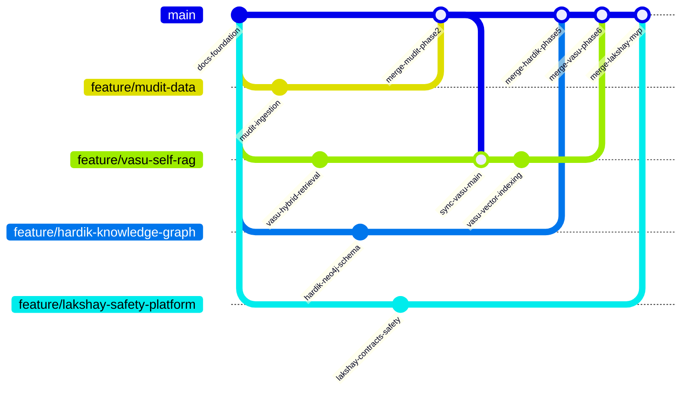

# RxGuard-RAG: Four-Team Contribution & Development Workflow

> **Repository:** [DAREDEVIL-OF-NEXUS/RxGuard-RAG](https://github.com/DAREDEVIL-OF-NEXUS/RxGuard-RAG)  
> **Target Branch:** `main` (Protected Integration Branch)  
> **Team Members:** Lakshay Bharti, Vasu Mittal, Mudit Bansal, Hardik  
> **Date:** October 2026

---

## 1. Branch Strategy & Workstream Ownership

To ensure parallel development across four engineers and their independent AI coding agents without merge conflicts, work is strictly partitioned into four primary feature branches:

| Engineer | Primary Feature Branch | Core Ownership Path |
|---|---|---|
| **Mudit Bansal** | `feature/mudit-data` | `src/rxguard/ingestion/`, `src/rxguard/knowledge/`, `src/rxguard/medications/`, `src/rxguard/database/` |
| **Vasu Mittal** | `feature/vasu-self-rag` | `src/rxguard/rag/`, `src/rxguard/vector_store/` |
| **Hardik** | `feature/hardik-knowledge-graph` | `src/rxguard/evidence/navigator.py` (the Neo4j graph was retired) |
| **Lakshay Bharti** | `feature/lakshay-safety-platform` | `src/rxguard/api/`, `src/rxguard/safety/`, `src/rxguard/auth/`, `src/rxguard/users/`, `src/rxguard/chatbot/`, `src/rxguard/evidence/` |

---

## 2. Step-by-Step Pull Request (PR) Workflow



1. **Branch Creation:** Each developer branches off `main` from the approved Phase 0 foundation commit:
   ```bash
   git checkout main
   git pull origin main
   git checkout -b feature/<your-assigned-branch-name>
   ```
2. **Contract Immutability:** Shared contracts located in `docs/api-contracts/` or `src/rxguard/core/contracts/` must **not** be modified unilaterally. Any schema change requires unanimous agreement and an updated ADR in `docs/decisions/`.
3. **Module Isolation:** Developers must not edit implementation files owned by another workstream without explicit written coordination. If your module needs functionality from another workstream, write against the published interface or mock contract.
4. **Commit Hygiene:** Use Conventional Commits:
   - `feat(ingestion): implement DailyMed SPL parser`
   - `test(retrieval): add hybrid RRF ranking unit tests`
   - `docs(rag): document the CRAG gate thresholds`
5. **PR Review Requirements:**
   - Every PR targeting `main` requires at least **one approved review** from another teammate.
   - All automated CI checks (`pytest`, `ruff check`, `mypy`) must pass with 100% success.
   - Zero decrease in test coverage for newly implemented modules (target $\ge 85\%$).
6. **Integration & Regression:** After a branch merges into `main`, all other active branches must rebase or merge `main` into their feature branch and verify integration tests before opening a PR.

---

## 3. Coordinating AI Coding Agents

When working with an autonomous or pair-programming AI coding agent (e.g., Antigravity, Claude Code, Cursor, Copilot Workspace):
1. **Provide the Member's Guide:** Give the agent the respective markdown guide (`docs/archive/Mudit.md`, `Vasu.md`, `Hardik.md`, or `Lakshay.md`).
2. **Enforce Boundary Constraints:** Remind the agent of its owned directory paths. Forbid the agent from editing foreign files or introducing uncoordinated contract shifts.
3. **Mock External Boundaries:** Instruct the agent to write unit tests against mocked dependencies using `pytest-mock` or `respx` rather than attempting to call another developer's unmerged code or live external APIs.
4. **Follow Definition of Done:** Do not consider a task complete until unit tests pass and code complies with project typing standards.
