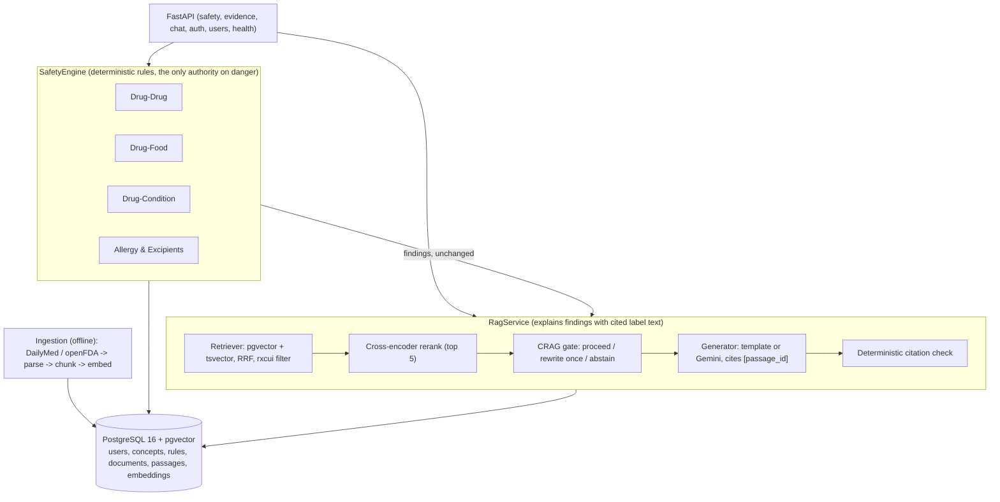
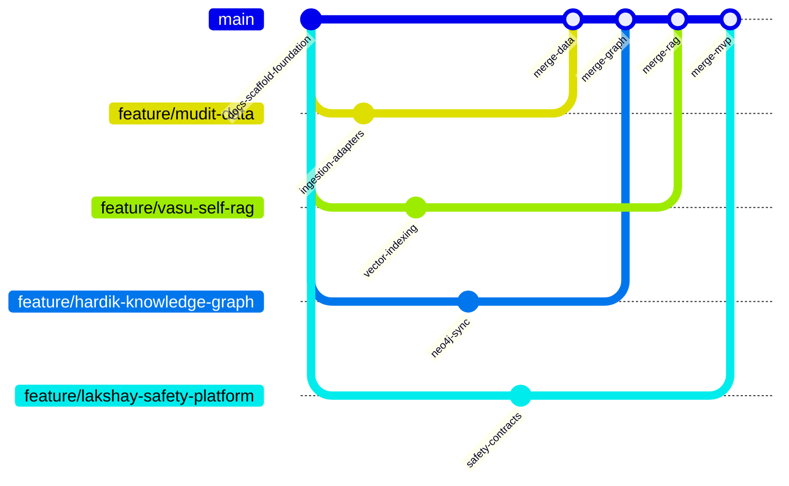

# RxGuard-RAG: Evidence-Grounded Medication Safety Intelligence

> **Tagline:** Evidence-grounded medication safety intelligence.  
> **Status:** Integrated release on `main` — Phases 0–13 implemented; Phase 14 deployment verified (demo video pending)  
> **Repository:** [DAREDEVIL-OF-NEXUS/RxGuard-RAG](https://github.com/DAREDEVIL-OF-NEXUS/RxGuard-RAG)  
> **Authors:** Lakshay Bharti, Vasu Mittal, Mudit Bansal, Hardik  
> **Version:** 2.0.0 (Four-Team Master Specification)  
> **Date:** October 2026

---

## 1. Project Overview & Identity

**RxGuard-RAG** is a research-oriented medication safety intelligence platform designed to eliminate hallucinations in clinical decision support. The platform pairs **deterministic clinical safety screening rules** with **Corrective Retrieval-Augmented Generation (CRAG) with deterministic citation checks** over authoritative regulatory drug labeling, all on PostgreSQL + pgvector.

In clinical medication safety, a missed contraindication can lead to severe adverse drug events or mortality, while an irrelevant passage can mislead a language model into generating false reassurance. RxGuard-RAG bridges this divide by enforcing strict symbolic boundaries: **an LLM is never the sole authority for detecting medication hazards, and an LLM can never override a validated safety rule with a reassuring explanation.**

---

## 2. Problem Statement

Preventable Adverse Drug Events (ADEs) result in millions of hospitalizations, severe morbidities, and billions in healthcare costs annually:
1. **Combinatorial Polypharmacy:** Patients with multimorbidity routinely take 5 to 15 concurrent medications, creating complex drug–drug and drug–food interactions that exceed human cognitive bandwidth during brief clinical consultations.
2. **Catastrophic Failure Modes of General LLMs:** Standard conversational AI models exhibit dangerous clinical blindspots:
   - Reassuring patients that hazardous drug combinations (e.g., Methotrexate + NSAIDs, Sildenafil + Nitrates) are safe.
   - Fabricating regulatory guidance or clinical citations that do not exist.
   - **Equating the absence of retrieved evidence with proof of safety.**
3. **Fragmented, Dense Regulatory Labels:** Authoritative FDA Structured Product Labeling (SPL) contains dozens of pages of unstructured text, making rapid clinical cross-referencing tedious.

---

## 3. Proposed Solution: Deterministic Safety + Grounded Explanation

RxGuard-RAG has two layers on one datastore. The deterministic `SafetyEngine` is the only authority on danger; `RagService` only explains findings with cited label text and can never change, soften or hide them (ADR-001).



- **SafetyEngine (`src/rxguard/safety/`):** symbolic rules for Drug–Drug, Drug–Food, Drug–Condition and Allergen/Excipient matching. Its findings are returned as-is.
- **RagService (`src/rxguard/rag/`):** six steps, one module each — scope to the request's RxCUIs and retrieve (`retriever.py`), rerank (`reranker.py`), CRAG gate (`gate.py`), generate (`generator.py`), check citations (`citations.py`), orchestrated by `service.py`.
- **Storage:** PostgreSQL 16 + pgvector is the only datastore. Keyword search uses Postgres `tsvector`; the Evidence Navigator is built from relational data on demand.

---

## 4. Target Users & Intended Scope

- **Clinical Informatics Researchers:** Investigating retrieval robustness, claim verification, and hybrid symbolic-neural architectures in healthcare.
- **Healthcare Professionals (Informational & Educational):** Rapidly navigating complex regulatory package inserts with precise section citations.
- **Informed Patients & Caregivers (Educational Research Prototype):** Understanding potential interaction risks and formulating informed questions for their prescribing physicians.

> [!WARNING] Mandatory Clinical Disclaimer
> RxGuard-RAG is an experimental research and educational prototype. It is **not** an FDA-cleared clinical decision support system or medical device. It does not provide medical diagnosis or treatment plans. Medication decisions must always be made in consultation with a licensed physician or pharmacist.

---

## 5. Core Features: MVP, Advanced & Flagship

### 5.1. Planned MVP Features (Phases 6–7)
- **Drug Identity Normalization:** Resolves user-entered brand/generic strings to RxNorm RxCUIs and UNII ingredients via RxNav.
- **500-Medication Concept Seed:** Seeded catalog of top outpatient and narrow-therapeutic-index drugs.
- **Cache-First Lookup:** Local PostgreSQL cache checked first; negative caching (7-day TTL) for genuine 404s.
- **Four Safety Screening Workflows:** Deterministic screening for DDI, DFI (food), DCI (contraindications), and Allergies/Excipients.
- **Baseline Semantic Retrieval:** Cosine vector search over indexed DailyMed sections via `pgvector`.
- **Structured Findings & Disclaimer:** Emits structured result states (`risk_identified`, `insufficient_evidence`, `no_issue_found_in_checked_sources`) with mandatory medical disclaimers.

### 5.2. Advanced Features (Phases 8–11)
- **Hybrid Search & Reranking:** Merges PostgreSQL `tsvector` keyword search and `pgvector` dense search (top 30 each) with Reciprocal Rank Fusion (RRF, $k=60$), filtered by RxCUI, then cross-encoder reranking (`bge-reranker-large`) to the top 5.
- **Corrective RAG (CRAG):** Gates on the top rerank score before generation: proceed, rewrite the query once, or abstain with `INSUFFICIENT`. Thresholds live in one block in `core/config.py`.
- **Deterministic Citation Check:** Every generated sentence must cite a retrieved `[passage_id]`; uncited sentences are dropped and recorded as `UNVERIFIED`.
- **Personalized Context-Isolated Chatbot:** Conversational assistant grounded in authorized user medical profile without cross-user leakage.
- **Security & Access Control:** Argon2id password hashing, JWT tokens, RBAC, TOTP 2FA (RFC 6238), and consent-driven emergency contacts.

### 5.3. Flagship Wow Feature: RxGuard Evidence Navigator (Phase 12)
An interactive, bidirectional visualizer tracing clinical reasoning from user inputs to regulatory source lines:
$$\text{User Input} \longrightarrow \text{Normalized Concept (RxCUI)} \longrightarrow \text{Active Ingredient} \longrightarrow \text{Deterministic Finding} \longrightarrow \text{Regulatory Label Section} \longrightarrow \text{Exact Passage} \longrightarrow \text{Entailed Claim}$$

---

## 6. Why CRAG and not Self-RAG

Self-RAG (Asai et al., 2023) relies on a model trained to emit reflection tokens (`[Retrieve]`, `[IsRel]`, `[IsSup]`). RxGuard-RAG uses no such model, so it uses Corrective RAG instead: the gate judges evidence quality before generation, and missing evidence leads to abstention, never to reassurance. Faithfulness is enforced by the deterministic citation check rather than by imitated reflection tokens. An NLI entailment model can later be added behind the same citation interface.

---

## 7. Evidence Navigator

`GET /api/v1/evidence/subgraph/{finding_id}` returns a Cytoscape/NetworkX-compatible `EvidenceProvenanceGraph` (finding -> medications -> passages -> documents), serialized on demand from the safety engine's findings. The interactive explorer is served at `/navigator`.

---

## 8. Technology Stack & Technical Justifications

| Layer | Component | Choice | Justification |
|---|---|---|---|
| **Runtime & Language** | Python 3.11+ | Modern typing, async I/O, native ML ecosystem. |
| **API Framework** | FastAPI | High-performance async routes, Pydantic v2 validation, OpenAPI documentation. |
| **Relational Database** | PostgreSQL 16+ | ACID single source of truth for users, concepts, rules, and audit logs. |
| **Vector Store** | `pgvector` | Native PostgreSQL extension for HNSW vector search; eliminates sync lag. |
| **Lexical Search** | PostgreSQL `tsvector` | Full-text ranking (`ts_rank_cd`) for exact chemical/dosage terms. |
| **Embeddings** | `BAAI/bge-small-en-v1.5` | 384-d sentence-transformers embeddings stored in pgvector. |
| **Reranker** | `bge-reranker-large` | Cross-encoder precision for candidate filtering. |
| **Generator** | Template or Gemini (`google-genai` SDK) | Grounded narrative that cites `[passage_id]`; template is the offline fallback. |
| **Authentication & 2FA** | Argon2id + PyJWT + PyOTP | Modern password hashing, secure tokens, and RFC 6238 TOTP 2FA. |
| **Testing & Linting** | `pytest`, `ruff`, `mypy` | Strict typing (`mypy --strict`), fast linting, and comprehensive test suites. |

---

## 9. Repository Structure

```
RxGuard-RAG/
├── README.md                  # Master project documentation
├── architecture.md            # Engineering blueprint & ADRs
├── data.md                    # Data catalog & schemas
├── CONTRIBUTING.md            # Git branch workflow and PR conventions
├── SECURITY.md                # Security policy, 2FA, RBAC & privacy
├── docs/                      # Diagrams, ADRs, research; archive/ holds the original phase plans
├── src/rxguard/
│   ├── api/                   # FastAPI routes & middleware
│   ├── auth/                  # Argon2id, JWT, 2FA & emergency contacts
│   ├── users/                 # User profiles & clinical context
│   ├── ingestion/             # DailyMed, openFDA, RxNav adapters & chunking
│   ├── knowledge/             # Normalizer & LOINC taxonomy
│   ├── database/              # PostgreSQL models & repositories
│   ├── vector_store/          # Embeddings & pgvector store
│   ├── rag/                   # RagService: retriever, reranker, gate, generator, citations
│   ├── safety/                # Deterministic DDI, DFI, DCI, allergy rules
│   ├── chatbot/               # Personalized chatbot orchestrator
│   ├── evidence/              # Evidence Navigator & chatbot claim verifier
│   └── evaluation/            # 50-case benchmark harness & RAG tier comparison
├── tests/                     # Unit, contract, rag, safety, security, e2e
├── data/                      # Seed catalog, synthetic & evaluation fixtures
├── migrations/                # Alembic database migrations
└── deployment/                # Production Docker Compose
```

---

## 10. Team Members & Workstream Ownership

| Team Member | Workstream Role | Primary Feature Branch | Core Ownership Paths | Blueprint Guide |
|---|---|---|---|---|
| **Mudit Bansal** | Data Engineering & Knowledge Layer | `feature/mudit-data` | `src/rxguard/ingestion/`, `src/rxguard/knowledge/`, `src/rxguard/database/` | [Mudit.md](docs/archive/Mudit.md) |
| **Vasu Mittal** | Advanced RAG | `feature/vasu-self-rag` | `src/rxguard/rag/`, `src/rxguard/vector_store/` | [Vasu.md](docs/archive/Vasu.md) |
| **Hardik** | Knowledge Graph (retired; Evidence Navigator now relational) | `feature/hardik-knowledge-graph` | `src/rxguard/evidence/navigator.py` | [Hardik.md](docs/archive/Hardik.md) |
| **Lakshay Bharti** | Safety Engine, Platform & Security | `feature/lakshay-safety-platform` | `src/rxguard/api/`, `src/rxguard/safety/`, `src/rxguard/auth/`, `src/rxguard/users/`, `src/rxguard/chatbot/`, `src/rxguard/evidence/` | [Lakshay.md](docs/archive/Lakshay.md) |

---

## 11. Git Branch Strategy & Integration Workflow



1. **Main Branch:** Protected integration branch. Zero direct commits allowed during development.
2. **Feature Branches:** Each member develops exclusively on their designated branch (`feature/mudit-data`, `feature/vasu-self-rag`, `feature/hardik-knowledge-graph`, `feature/lakshay-safety-platform`).
3. **Pull Request Protocol:** Every PR requires at least 1 peer approval, 100% passing CI checks (`pytest`, `ruff check`, `mypy`), and adherence to shared contracts.

---

## 12. Testing & Evaluation Regimen

1. **Contract Tests:** Verifying serialization and backward-compatibility of all 8 Pydantic contracts.
2. **Unit & Safety Regression Tests:** 100% coverage on deterministic safety paths (DDI, DFI, DCI, Allergies).
3. **Security & Isolation Tests:** Verifying password hashing, JWT expiration, TOTP 2FA verification, and preventing cross-user context leakage.
4. **50-Scenario Synthetic Benchmark (Phase 13):**
   - Evaluating: Recall@K, Precision@K, Mean Reciprocal Rank (MRR), RAGAS Faithfulness, RAGAS Relevancy, Citation Support Rate, and Clinical Safety Sensitivity across 2 RAG tiers (vector only vs RagService).

---

## 13. Quickstart

```bash
git clone https://github.com/DAREDEVIL-OF-NEXUS/RxGuard-RAG.git
cd RxGuard-RAG
cp .env.example .env            # set POSTGRES_PASSWORD, JWT_SECRET_KEY

# PostgreSQL 16 + pgvector, migrations, and the API on :8000.
docker compose -f deployment/docker-compose.prod.yml --env-file .env up -d --build --wait
```

Then open the **Evidence Navigator** at <http://localhost:8000/navigator> or the API docs at
<http://localhost:8000/docs>.

### Local development

```bash
pip install -e ".[dev,ml]"      # Python 3.11+
docker compose up -d --wait     # PostgreSQL only (needs .env)
pytest                          # runs with MODEL_MODE=fake; integration tests use Docker via testcontainers
ruff check . && mypy src/rxguard
uvicorn src.rxguard.api.main:app --reload
```

`DATABASE_URL` (environment or `.env`) switches the API to PostgreSQL; set it empty to run fully in memory (explanations then abstain: there is no corpus).

| Task | Command |
|---|---|
| **Run everything** (Postgres, migrations, drug catalogue, FDA labels on first run, backend + frontend) | `make start` |
| Backend + frontend without a database | `make dev` |
| Fetch FDA labels for more drugs and embed them | `make ingest LIMIT=50` |
| Regenerate rules for the whole catalogue (DDInter + ingested label text) into `data/generated/` | `make rules` |
| Stop Postgres (data is kept) | `make stop` |
| **Production** (HTTPS, bootstrap, backups): see [docs/PRODUCTION.md](docs/PRODUCTION.md) | `make prod-up` |
| Re-fetch labels and rebuild rules | `make refresh` |
| Re-pin dependencies (`requirements.lock`) | `make lock` |
| Show who writes answers (Gemini or quoted label text) | `make llm-status` |
| Send one test request to Gemini with the key in `.env` | `make llm-check` |
| Use the offline test models instead of the real ones | `make start MODEL_MODE=fake` |
| Apply database migrations | `alembic upgrade head` |
| Seed the 500-drug catalogue | `python -m src.rxguard.ingestion.seed_loader` |

### Models and thresholds

| Setting | Values | Notes |
|---|---|---|
| `MODEL_MODE` | `real` / `fake` | `real` (default): `BAAI/bge-small-en-v1.5` embeddings + `BAAI/bge-reranker-large`, needs `pip install -e ".[ml]"`. `fake`: offline test doubles. |
| `LLM_BACKEND` | `template` / `gemini` | `gemini` uses `GEMINI_MODEL` (default `gemini-3.8-flash`) and needs `GEMINI_API_KEY`; install with `pip install -e ".[llm]"` |
| `RETRIEVAL_TOP_K`, `RERANK_TOP_K`, `RERANK_MIN_SCORE`, `GATE_PROCEED_SCORE`, `GATE_REWRITE_SCORE`, `MAX_REWRITES` | numbers | The only RAG thresholds; defaults in `src/rxguard/core/config.py`. |

Whatever the backend, deterministic safety findings are never overridden by generated text (ADR-001).

### Rules beyond the curated rulebook

The 17 curated rules in `data/seed/safety_rules.json` are clinically reviewed. `make rules` adds generated rules for the rest of the catalogue, and the app tags their findings as *Unreviewed*:

- **DDInter** drug pairs (Major / Moderate / Minor), matched to catalogue drugs by name, brand or ingredient.
- **FDA label text** that is already ingested. A Drug Interactions or Warnings sentence naming another catalogue drug, or a food from `data/seed/foods.json`, becomes a rule that cites that passage.

When rules overlap, curated beats DDInter, which beats label text. The output is git-ignored; run `make ingest` first so label rules have text to read.

Condition search uses the full ICD-10-CM list from NLM Clinical Tables. Offline, it falls back to the rulebook's conditions.

The 50-scenario evaluation set lives in `data/benchmark/scenarios_50.json`.

---

## 14. Authoritative References & Acknowledgments

- **National Library of Medicine (NLM):** DailyMed Structured Product Labeling & RxNorm / RxNav terminology services.
- **U.S. Food & Drug Administration (FDA):** openFDA drug labeling APIs and UNII database.
- **DDInter** (https://ddinter.scbdd.com): Xiong G. et al., *DDInter: an online drug–drug interaction database towards improving clinical decision-making and patient safety*, Nucleic Acids Research, 2022. Licensed CC BY-NC-SA 4.0, used here for non-commercial research only; downloaded at build time and not redistributed.
- **NLM Clinical Tables** ICD-10-CM search API (condition search).
- **Self-RAG: Learning to Retrieve, Generate, and Critique through Self-Reflection:** Asai et al., 2023 (considered; see section 6).
- **Corrective Retrieval-Augmented Generation (CRAG):** Yan et al., 2024.
- **RAGAS (Retrieval Augmented Generation Assessment):** Shahul et al., 2023.
