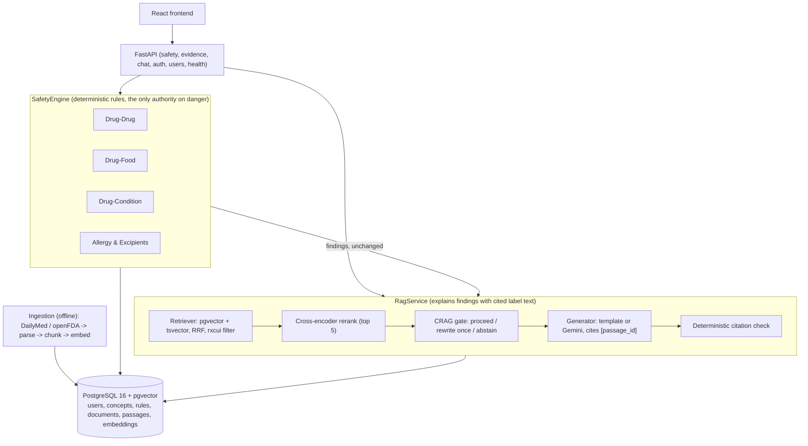

# LabelSafe

**Medication safety checks grounded in official FDA drug labels.**

> **Author:** Hardik Sachdeva
> **Repository:** [hxrdikk21/label-safe](https://github.com/hxrdikk21/label-safe)
> **Type:** Personal project, research and educational prototype

LabelSafe checks a list of medicines against your foods, conditions and allergies, and flags risky combinations. Deterministic rules decide what is dangerous. A retrieval-augmented explainer then quotes the exact FDA label passages behind each finding. An LLM can explain a finding, but it can never create, soften or hide one.

> [!WARNING]
> LabelSafe is a personal research prototype. It is **not** a medical device or an FDA-cleared clinical decision support system, and it does not give medical advice. Always talk to a doctor or pharmacist before changing any medication.

---

## Why I built it

Many people take five or more medicines at once, and the number of possible drug–drug and drug–food interactions grows fast. General-purpose chatbots handle this badly. They may call a dangerous combination (for example methotrexate + NSAIDs, or sildenafil + nitrates) safe, invent citations, or treat "I found nothing" as "it's safe". FDA labels hold the real answers, but they run to dozens of pages of dense text.

I wanted a tool where the safety decision is never left to a language model, and every explanation can be traced back to a sentence in an official label.

---

## How it works

Two layers share one datastore:

- **SafetyEngine** (`src/labelsafe/safety/`): symbolic rules for Drug–Drug, Drug–Food, Drug–Condition and Allergy/Excipient checks. It is the only authority on danger, and its findings are returned as-is.
- **RagService** (`src/labelsafe/rag/`): explains each finding with cited label text. It can never change a finding (ADR-001).



The RAG pipeline has six steps, one module each: retrieve within the request's RxCUIs (`retriever.py`), rerank (`reranker.py`), CRAG gate (`gate.py`), generate (`generator.py`) and check citations (`citations.py`), all orchestrated by `service.py`.

### Why CRAG and not Self-RAG

Self-RAG needs a model trained to emit reflection tokens, and I don't use one. Corrective RAG judges evidence quality *before* generation instead. When the evidence is missing, the result is an abstention, never reassurance. A deterministic citation check enforces faithfulness, and an NLI entailment model could later sit behind the same interface.

---

## Features

- **Drug normalization:** brand and generic names are resolved to RxNorm RxCUIs and UNII ingredients via RxNav.
- **500-drug seed catalogue** of common outpatient and narrow-therapeutic-index medicines, with cache-first lookup and negative caching.
- **Four safety screeners:** drug–drug, drug–food, drug–condition and allergy/excipient.
- **Structured result states:** `risk_identified`, `insufficient_evidence`, `no_issue_found_in_checked_sources`. "Nothing found" is never presented as "safe".
- **Hybrid retrieval:** Postgres `tsvector` and `pgvector` (top 30 each) merged with Reciprocal Rank Fusion (k=60), then cross-encoder reranking to the top 5.
- **CRAG gate:** proceed, rewrite the query once, or abstain.
- **Deterministic citation check:** every generated sentence must cite a retrieved `[passage_id]`. Uncited sentences are dropped and marked `UNVERIFIED`.
- **Personal chatbot** grounded in the signed-in user's own profile, with no cross-user leakage.
- **Evidence Navigator:** traces every finding from input → RxCUI → ingredient → rule → label section → exact passage. The graph is served at `GET /api/v1/evidence/subgraph/{finding_id}` and explored at `/navigator`.
- **Accounts and security:** Argon2id hashing, JWT, TOTP 2FA (RFC 6238), rate limiting, per-user profiles.
- **Frontend:** a React + Vite app with a "pharmacy label" design. Pick medicines, conditions and allergies, then read the findings with their cited explanations.

---

## Tech stack

| Layer | Choice | Why |
|---|---|---|
| Language | Python 3.11+ | Typing, async I/O, ML ecosystem |
| API | FastAPI + Pydantic v2 | Async routes, validation, OpenAPI docs |
| Database | PostgreSQL 16 | Single source of truth for users, concepts, rules, documents |
| Vector search | `pgvector` (HNSW) | Lives in the same database, so there's no sync lag |
| Keyword search | Postgres `tsvector` | Exact drug and dosage terms (`ts_rank_cd`) |
| Embeddings | `BAAI/bge-small-en-v1.5` | 384-d sentence-transformers |
| Reranker | `BAAI/bge-reranker-base` | Cross-encoder precision |
| Generator | Template or Gemini (`google-genai`) | The template is the offline fallback |
| Auth | Argon2id + PyJWT + PyOTP | Password hashing, tokens, 2FA |
| Frontend | React 19 + Vite | Single-page app |
| Hosting | Vercel (website) + Render (API) + Neon (Postgres) | Free tiers; see [deploy.md](deploy.md) |
| Quality | `pytest`, `ruff`, `mypy --strict`, `oxlint` | Run in CI |

---

## Repository structure

```
label-safe/
├── src/labelsafe/
│   ├── api/            # FastAPI app, routes, middleware
│   ├── auth/           # Argon2id, JWT, 2FA, rate limiting
│   ├── users/          # Profiles and clinical context
│   ├── ingestion/      # DailyMed, openFDA, RxNav adapters, seed loader
│   ├── knowledge/      # Normalizer, LOINC taxonomy
│   ├── database/       # SQLAlchemy models and repositories
│   ├── vector_store/   # Embeddings and pgvector store
│   ├── rag/            # Retriever, reranker, gate, generator, citations
│   ├── safety/         # Deterministic DDI, DFI, DCI, allergy rules
│   ├── chatbot/        # Profile-aware chatbot
│   ├── evidence/       # Evidence Navigator
│   ├── evaluation/     # 50-scenario benchmark harness
│   └── ops/            # Bootstrap and refresh jobs
├── frontend/           # React + Vite app
├── tests/              # unit, contract, rag, safety, security, integration, e2e
├── data/               # Seed catalogue, generated rules, foods, benchmark scenarios
├── migrations/         # Alembic migrations
├── scripts/            # Seed catalogue builder
├── render.yaml         # Render Blueprint for the API (frontend/vercel.json forwards /api to it)
├── DEPLOY_STEPS.md     # Click-by-click deployment checklist
└── deploy.md           # Deployment guide and troubleshooting (Vercel + Render + Neon)
```

---

## Deploy

LabelSafe deploys for free in three parts: the website on **Vercel**, the API on **Render**, and the database on **Neon**. Vercel forwards `/api` to Render, so the browser only ever talks to one address. Follow the checklist in [DEPLOY_STEPS.md](DEPLOY_STEPS.md); [deploy.md](deploy.md) explains the setup and covers troubleshooting.

The deployed API runs in **lite mode** (`MODEL_MODE=fake`): the torch models don't fit in the free 512 MB instance, so label search uses a built-in lightweight embedder and word-overlap reranker. Safety findings are identical in both modes (they come from deterministic rules) and Gemini still writes the explanations. Run `MODEL_MODE=real` locally for the full models.

---

## Run locally

```bash
git clone https://github.com/hxrdikk21/label-safe.git
cd label-safe
make start                      # creates .env, .venv, Postgres, data; backend :8000 + frontend :5173
```

Open <http://localhost:5173> for the app, <http://localhost:8000/navigator> for the Evidence Navigator, or <http://localhost:8000/docs> for the API docs.

Or step by step:

```bash
pip install -e ".[dev,ml]"      # Python 3.11+; drop ",ml" to skip torch (lite mode)
docker compose up -d --wait     # PostgreSQL only (needs .env)
pytest                          # MODEL_MODE=fake; integration tests use testcontainers
ruff check . && mypy src/labelsafe
uvicorn src.labelsafe.api.main:app --reload
npm --prefix frontend run dev
```

`DATABASE_URL` (from the environment or `.env`) points the API at PostgreSQL. Leave it empty to run fully in memory. Explanations then abstain, because there is no corpus.

| Task | Command |
|---|---|
| **Run everything** (Postgres, migrations, catalogue, FDA labels on first run, backend + frontend) | `make start` |
| Backend + frontend without a database | `make dev` |
| Fetch and embed FDA labels for more drugs | `make ingest LIMIT=50` |
| Generate rules for the whole catalogue into `data/generated/` | `make rules` |
| Re-fetch labels and rebuild rules | `make refresh` |
| Run the RAG evaluation | `make rag-eval` |
| Show which generator is active (Gemini or quoted label text) | `make llm-status` |
| Send one test request to Gemini | `make llm-check` |
| Use offline test models | `make start MODEL_MODE=fake` |
| Stop Postgres (data is kept) | `make stop` |
| Copy the local database to Neon for deployment (see [deploy.md](deploy.md)) | `make neon-copy NEON_URL=…` |
| Re-pin dependencies (`uv.lock`) | `make lock` |

---

## Configuration

| Setting | Values | Notes |
|---|---|---|
| `MODEL_MODE` | `real` / `fake` | `real` uses the bge embedder and reranker and needs `pip install -e ".[ml]"` (the default when it's installed). `fake` is lite mode: hashed embeddings and a word-overlap reranker, used in the deployed API and in tests. |
| `LLM_BACKEND` | `template` / `gemini` | `gemini` uses `GEMINI_MODEL` (default `gemini-3.8-flash`) and needs `GEMINI_API_KEY`. |
| `RETRIEVAL_TOP_K`, `RERANK_TOP_K`, `RERANK_MIN_SCORE`, `GATE_PROCEED_SCORE`, `GATE_REWRITE_SCORE`, `MAX_REWRITES` | numbers | The only RAG thresholds. Defaults are in `src/labelsafe/core/config.py`. |

Whatever the backend, generated text never overrides a deterministic finding.

### Rules beyond the curated rulebook

The 17 curated rules in `data/seed/safety_rules.json` are hand-reviewed. `make rules` adds generated rules for the rest of the catalogue, and the app tags their findings as *Unreviewed*:

- **DDInter** drug pairs (Major / Moderate / Minor), matched to catalogue drugs by name, brand or ingredient.
- **Ingested FDA label text:** a Drug Interactions or Warnings sentence that names another catalogue drug, or a food from `data/seed/foods.json`, becomes a rule that cites that passage.

When rules overlap, curated beats DDInter, and DDInter beats label text. The output is git-ignored. Run `make ingest` first so the label rules have text to read. Condition search uses the full ICD-10-CM list from NLM Clinical Tables, and falls back to the rulebook's conditions when offline.

---

## Testing and evaluation

- **Contract tests** for the Pydantic data contracts.
- **Safety regression tests** on every deterministic screening path.
- **Security tests:** password hashing, JWT expiry, TOTP, rate limits, and isolation between users' medical profiles.
- **RAG tests:** retrieval, gate, generator and citation checking.
- **50-scenario benchmark** (`data/benchmark/scenarios_50.json`): Recall@K, Precision@K, MRR, faithfulness, relevancy, citation support rate and safety sensitivity, comparing vector-only retrieval with the full RagService.

CI runs `ruff`, `mypy`, `pytest`, the frontend lint and a frontend build.

---

## Data sources and references

- **National Library of Medicine:** DailyMed Structured Product Labeling, RxNorm / RxNav, and the Clinical Tables ICD-10-CM API.
- **U.S. FDA:** openFDA drug labeling API and the UNII database.
- **DDInter** (https://ddinter.scbdd.com): Xiong G. et al., *DDInter: an online drug–drug interaction database towards improving clinical decision-making and patient safety*, Nucleic Acids Research, 2022. Licensed CC BY-NC-SA 4.0 and used here for non-commercial research only. It is downloaded at build time and not redistributed.
- **CRAG:** Yan et al., *Corrective Retrieval Augmented Generation*, 2024.
- **Self-RAG:** Asai et al., 2023 (considered, not used).
- **RAGAS:** Shahul et al., 2023.
