# RxGuard-RAG: Master System Architecture & Engineering Blueprint

> **Status:** PLANNED SPECIFICATION (Documentation-Only Foundation)  
> **Repository:** [DAREDEVIL-OF-NEXUS/RxGuard-RAG](https://github.com/DAREDEVIL-OF-NEXUS/RxGuard-RAG)  
> **Core Architecture Team:** Lakshay Bharti, Vasu Mittal, Mudit Bansal, Hardik  
> **Version:** 2.0.0 (Four-Team Master Specification)  
> **Date:** October 2026

---

## 1. System Overview: SafetyEngine + RagService on PostgreSQL

RxGuard-RAG is a research-grade medication safety intelligence platform designed to eliminate the risks of language model hallucinations in clinical settings. Since the October 2026 simplification (ADR-005) it has two layers on one datastore:

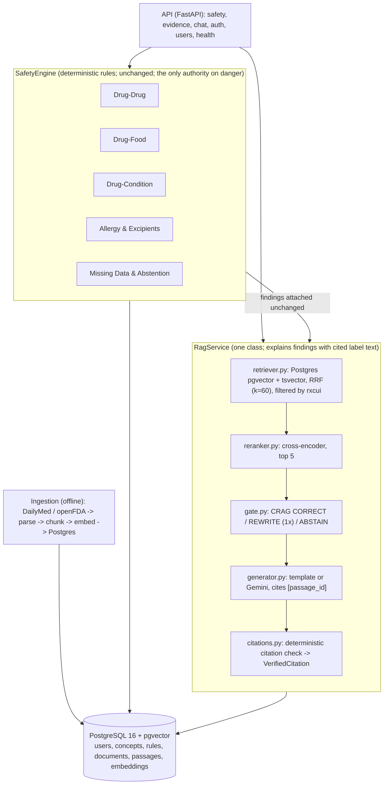

### Responsibilities

1. **SafetyEngine (`src/rxguard/safety/`)**
   - Symbolic, source-backed rule evaluation across four workflows: Drug–Drug, Drug–Food, Drug–Condition, and Allergy & Inactive Ingredient cross-sensitivities.
   - Structured result states (`risk_identified`, `no_issue_found_in_checked_sources`, `insufficient_evidence`, `ambiguous_medication_identity`, `conflicting_evidence`, `requires_professional_review`, `check_unavailable`).
   - Strict clinical fail-safe: generated text can **never** override a deterministic finding (ADR-001).

2. **RagService (`src/rxguard/rag/`)** — six steps, one module each:
   1. **Resolve scope:** the request's medications give the RxCUIs; candidates are filtered by `rxcui`.
   2. **Retrieve:** pgvector cosine top 30 + `tsvector` top 30, fused with Reciprocal Rank Fusion (k=60).
   3. **Rerank:** cross-encoder scores (query, passage); keep the top 5 above a minimum score.
   4. **CRAG gate:** top rerank score >= `GATE_PROCEED_SCORE` continues; between the two thresholds the query is rewritten once and re-gated; below `GATE_REWRITE_SCORE` it abstains with `evidence_sufficiency_state="INSUFFICIENT"`. A result still ambiguous after the rewrite returns `PARTIAL`; it never proceeds silently.
   5. **Generate:** the top passages are formatted (`ContextBuilder`); the generator is the template or Gemini, told to use only the passages and cite `[passage_id]`.
   6. **Check citations:** every sentence must cite a retrieved passage; others are dropped and recorded as `UNVERIFIED`. The `RAGResponse` carries the SafetyEngine findings unchanged.

3. **Storage:** PostgreSQL 16 + pgvector is the only datastore (canonical records, passages, embeddings, keyword search via `tsvector`). Embeddings are a derived index, rebuildable from `evidence_passages`.

4. **Ingestion (`src/rxguard/ingestion/`):** DailyMed SPL XML / openFDA JSON parsed into LOINC sections, packed into passages of at most 1500 characters that each start with a `[DRUG][SECTION][LOINC][RXCUI]` header.

5. **Application (`src/rxguard/api/`, `auth/`, `users/`, `chatbot/`, `evidence/`):** FastAPI gateway, RBAC, 2FA, emergency contacts, the personalized chatbot, and the Evidence Navigator.

All RAG thresholds (`RETRIEVAL_TOP_K`, `RERANK_TOP_K`, `RERANK_MIN_SCORE`, `GATE_PROCEED_SCORE`, `GATE_REWRITE_SCORE`, `MAX_REWRITES`) and `MODEL_MODE=real|fake` live in one block in `src/rxguard/core/config.py`.

---

## 2. Workstreams

The original four-team workstream split (including the retired Neo4j knowledge-graph workstream) is kept for reference in `docs/archive/`.

---

## 3. Cache-First / Local-First Medication Lookup Flow

To minimize external API dependency, respect rate limits, and ensure deterministic reproducibility, the system enforces a local-first retrieval sequence:

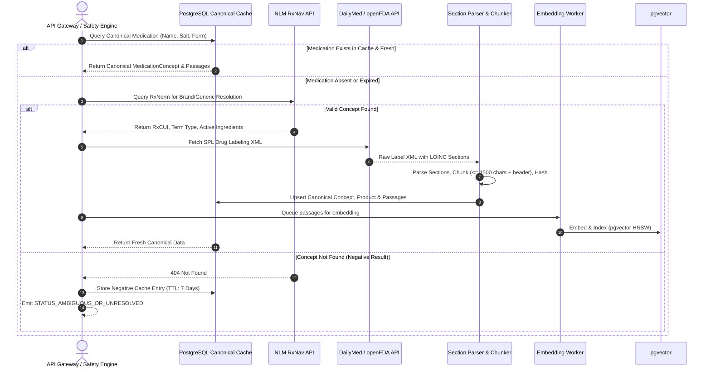

---

## 4. Data Ingestion, Section Extraction & Embedding Pipeline

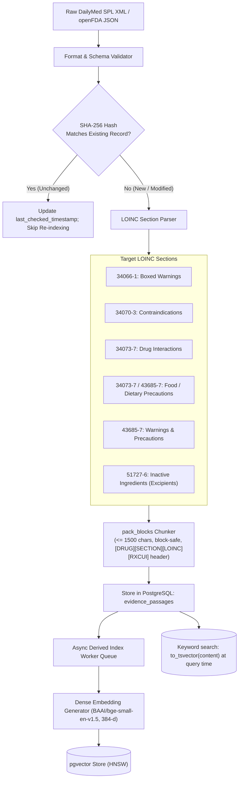

---

## 5. Persistence & Consistency Model

PostgreSQL 16 + pgvector is the only datastore. `evidence_passages` holds the canonical passage text; `evidence_embeddings` (pgvector, HNSW cosine) is a derived index that cascade-deletes with its passage and can be rebuilt at any time. Keyword search runs `to_tsvector('english', content)` over `evidence_passages` directly, so there is nothing to keep in sync. The `derived_sync_status` table still tracks pending pgvector work per passage.

---

## 6. Corrective RAG Workflow (CRAG, not Self-RAG)

Self-RAG (Asai et al., 2023) depends on a model trained to emit reflection tokens (`[Retrieve]`, `[IsRel]`, `[IsSup]`). RxGuard-RAG has no such model, so it uses Corrective RAG: the gate judges the evidence before generation, and missing evidence is never treated as proof of safety. Faithfulness is enforced by a deterministic citation check; an NLI entailment model can later be added behind the same interface (ADR-005).

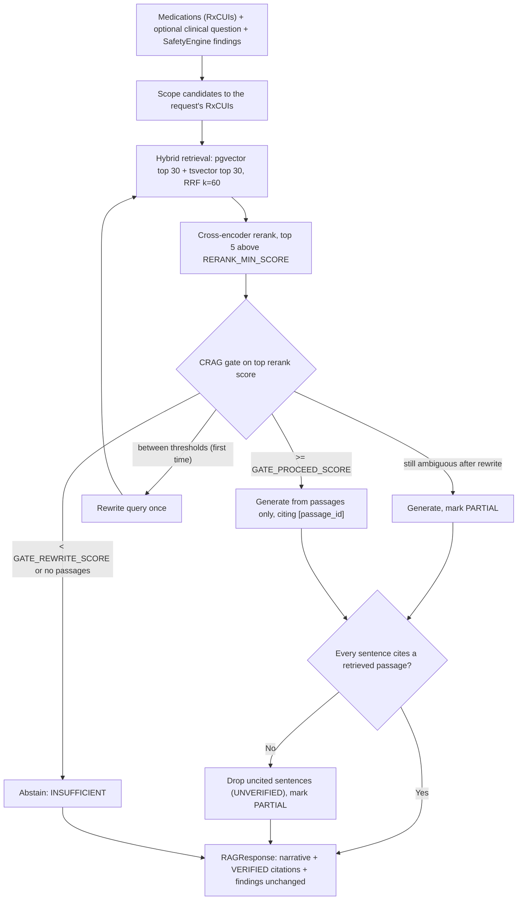

---

## 7. Four Clinical Safety Analysis Workflows

### 7.1. Drug–Drug Interaction (DDI) Workflow
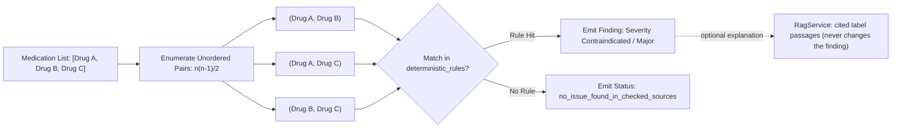

### 7.2. Drug–Food Interaction (DFI) Workflow
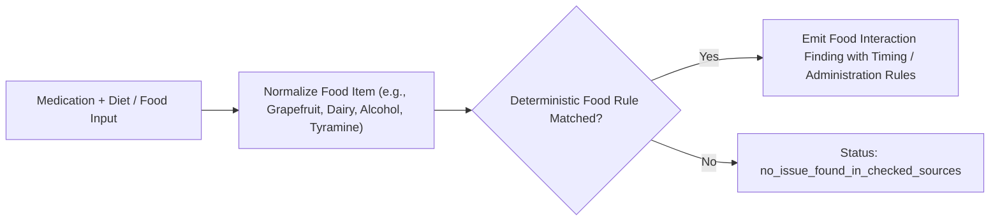

### 7.3. Drug–Condition Contraindication (DCI) Workflow
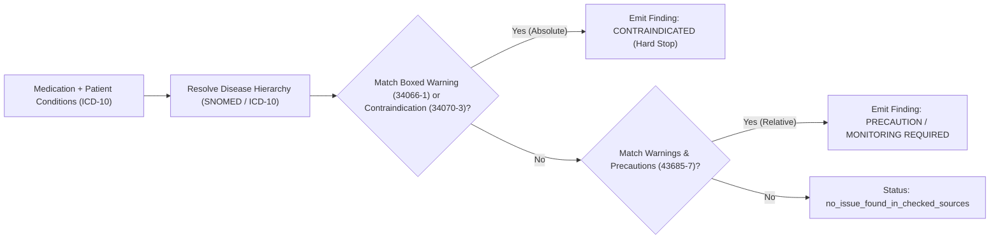

### 7.4. Allergy & Inactive Ingredient Cross-Sensitivity Workflow
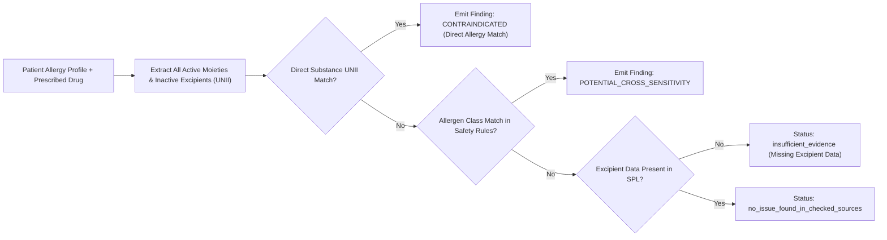

---

## 8. Personalized Chatbot & Authorized User Context Architecture

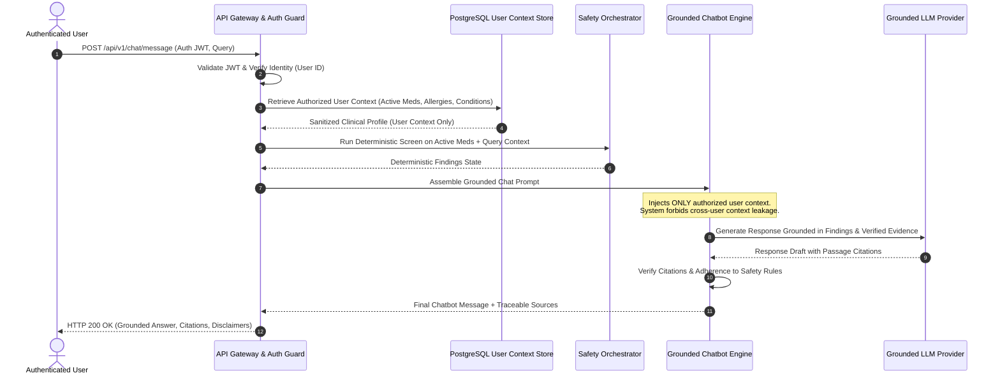

---

## 9. Authentication, RBAC, 2FA & Emergency Contacts Security

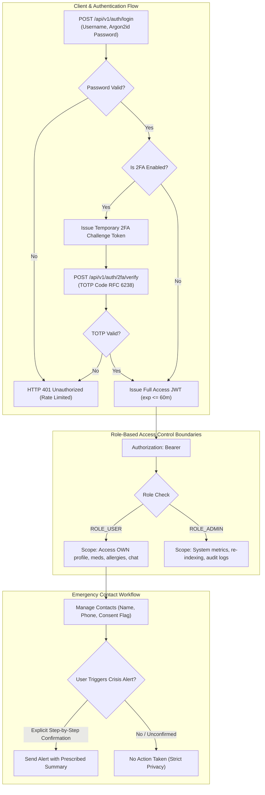

---

## 10. Flagship Wow Feature: RxGuard Evidence Navigator Architecture

The **RxGuard Evidence Navigator** provides an interactive, traceable, bidirectional exploration interface bridging raw user input to regulatory source lines.

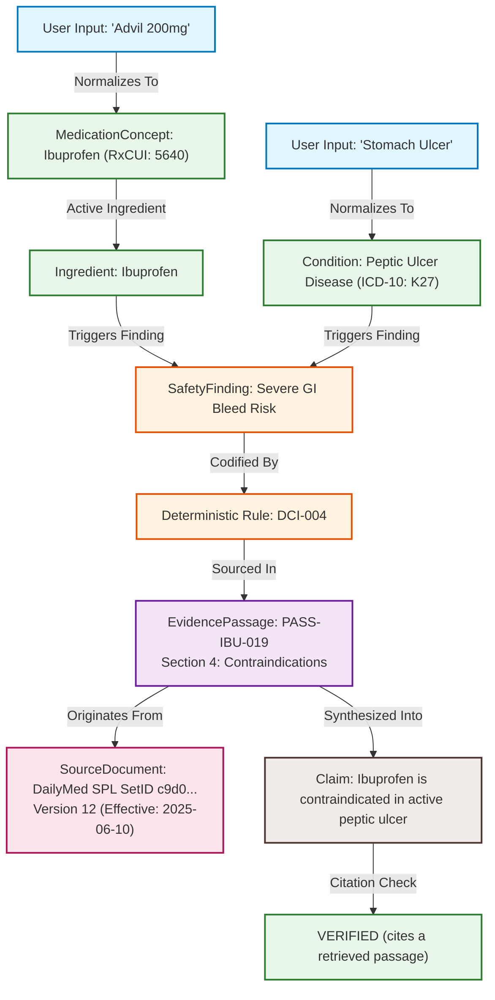

The navigator graph (`EvidenceProvenanceGraph`) is serialized on demand from the SafetyEngine finding and relational data; there is no separate graph database.

---

## 11. Canonical Shared Contracts & Pydantic Data Models

All four workstreams share immutable Pydantic contracts located under `src/rxguard/core/contracts/`:

### 11.1. MedicationConcept Contract
```python
# src/rxguard/core/contracts/medication.py (Planned Contract)
from pydantic import BaseModel, Field
from typing import List, Optional

class IngredientReference(BaseModel):
    unii: str = Field(..., description="FDA Unique Ingredient Identifier")
    name: str = Field(..., description="Normalized chemical substance name")
    is_active: bool = Field(True, description="True if active moiety, False if inactive excipient")

class MedicationConcept(BaseModel):
    rxcui: str = Field(..., description="RxNorm Concept Unique Identifier")
    canonical_name: str = Field(..., description="Normalized generic or clinical brand name")
    term_type: str = Field(..., description="RxNorm TTY (e.g., IN, PIN, SCD, SBD)")
    ingredients: List[IngredientReference] = Field(default_factory=list)
    synonyms: List[str] = Field(default_factory=list)
    jurisdiction: str = Field("US", description="Regulatory jurisdiction e.g. US, IN, GLOBAL")
    is_ambiguous: bool = Field(False)
```

### 11.2. DrugProduct Contract
```python
# src/rxguard/core/contracts/product.py (Planned Contract)
class DrugProduct(BaseModel):
    ndc: str = Field(..., description="National Drug Code")
    brand_name: str
    non_proprietary_name: str
    dosage_form: str
    route: str
    strength: str
    rxcui_scd: Optional[str] = None
    spl_setid: str
    active_ingredient_uniis: List[str]
    inactive_excipient_uniis: List[str] = Field(default_factory=list)
```

### 11.3. SourceDocument Contract
```python
# src/rxguard/core/contracts/document.py (Planned Contract)
from datetime import datetime
from pydantic import HttpUrl

class SourceDocument(BaseModel):
    document_id: str = Field(..., description="DailyMed SPL SetID or openFDA application ID")
    source_name: str = Field(..., description="DailyMed, openFDA, RxNav, CDSCO")
    source_url: HttpUrl
    version: str
    effective_date: str
    retrieval_timestamp: datetime
    sha256_hash: str
    jurisdiction: str = "US"
```

### 11.4. EvidencePassage Contract
```python
# src/rxguard/core/contracts/evidence.py (Planned Contract)
class EvidencePassage(BaseModel):
    passage_id: str = Field(..., description="UUID representing the chunk")
    document_id: str
    rxcui: str
    loinc_section_code: str
    section_title: str
    passage_index: int
    text: str
    chunk_version: str
    embedding_status: str  # "INDEXED", "PENDING", "FAILED"
    sha256_hash: str
```

### 11.5. SafetyEvidence Contract
```python
# src/rxguard/core/contracts/safety_evidence.py (Planned Contract)
class SafetyEvidence(BaseModel):
    evidence_id: str
    passage_id: str
    finding_type: str  # "DDI", "DFI", "DCI", "ALLERGY"
    involved_rxcuis: List[str]
    condition_icd10: Optional[str] = None
    food_identifier: Optional[str] = None
    substance_unii: Optional[str] = None
    qualifiers: List[str] = Field(default_factory=list)
    verification_status: str  # "VERIFIED", "CONTRADICTED", "UNASSESSED"
```

### 11.6. SafetyFinding Contract
```python
# src/rxguard/core/contracts/finding.py (Planned Contract)
from enum import Enum

class FindingSeverity(str, Enum):
    CONTRAINDICATED = "CONTRAINDICATED"
    MAJOR = "MAJOR"
    MODERATE = "MODERATE"
    MINOR = "MINOR"
    PRECAUTION = "PRECAUTION"
    UNKNOWN_SEVERITY = "UNKNOWN_SEVERITY"

class SafetyFinding(BaseModel):
    finding_id: str
    finding_type: str
    subject_medications: List[str]
    status: str  # "risk_identified", "insufficient_evidence", etc.
    severity: FindingSeverity
    rule_id: Optional[str] = None
    supporting_evidence_ids: List[str] = Field(default_factory=list)
    clinical_explanation: str
    actionable_warning: str
    requires_professional_review: bool = True
```

### 11.7. RAGResponse Contract
```python
# src/rxguard/core/contracts/rag_response.py (Planned Contract)
class VerifiedCitation(BaseModel):
    citation_id: str
    passage_id: str
    cited_sentence: str
    entailment_score: float
    verification_status: str

class RAGResponse(BaseModel):
    response_id: str
    findings: List[SafetyFinding]
    grounded_narrative: str
    verified_citations: List[VerifiedCitation]
    unresolved_questions: List[str]
    evidence_sufficiency_state: str  # "SUFFICIENT", "PARTIAL", "INSUFFICIENT"
    missing_data_warnings: List[str]
    disclaimer: str
```

### 11.8. UserContext Contract
```python
# src/rxguard/core/contracts/user_context.py (Planned Contract)
class UserAllergyRecord(BaseModel):
    allergen_name: str
    substance_unii: Optional[str] = None
    severity: str
    verification_source: str  # "USER_REPORTED", "CLINICIAN_VERIFIED"

class UserConditionRecord(BaseModel):
    condition_name: str
    icd10_code: Optional[str] = None
    onset_date: Optional[str] = None

class UserContext(BaseModel):
    user_id: str
    roles: List[str]
    active_medications: List[str]
    allergies: List[UserAllergyRecord]
    conditions: List[UserConditionRecord]
    emergency_contacts_enabled: bool = False
```

---

## 12. Architectural Decision Records (ADRs)

### ADR-001: Five-Layer Architecture with Strict Symbolic-Neural Boundary
- **Status:** ACCEPTED (October 2026)
- **Decision:** Critical clinical safety checks (DDI, DFI, DCI, Allergies) execute in Layer C deterministic Python rules. The LLM in Layer D is strictly restricted to synthesizing explanations over retrieved passages. An LLM can never override a deterministic finding.

### ADR-002: Tri-Store Persistence with PostgreSQL as Canonical Authority
- **Status:** SUPERSEDED by ADR-005 (October 2026)
- **Decision:** PostgreSQL 16+ is the single source of truth for all users, concepts, rules, and raw documents. `pgvector` (vectors) and Neo4j (graph) are derived stores populated asynchronously and are fully rebuildable from PostgreSQL.

### ADR-003: Practical Self-RAG Implementation over Fine-Tuned Models
- **Status:** SUPERSEDED by ADR-005 (October 2026)
- **Decision:** Rather than fine-tuning an offline language model with reflective tokens (Asai et al., 2023), RxGuard-RAG implements a modular pipeline with calibrated evaluation steps, NLI entailment scoring (`roberta-large-mnli`), and bounded corrective query reformulation.

### ADR-004: Neo4j as Dedicated Graph Database for Evidence Provenance
- **Status:** SUPERSEDED by ADR-005 (October 2026)
- **Decision:** Deploy Neo4j 5+ to model multi-hop entity relationships (Medication -> Product -> Ingredient -> Rule -> Passage). Neo4j powers graph-assisted retrieval and the interactive RxGuard Evidence Navigator.

### ADR-005: One Datastore, One RAG Path (CRAG), Deterministic Citation Check
- **Status:** ACCEPTED (October 2026)
- **Decision:** PostgreSQL 16 + pgvector is the only datastore; Neo4j and Redis are removed and the Evidence Navigator is built from relational data. The RAG layer is a single `RagService` (retrieve, rerank, CRAG gate, generate, citation check); the imitated Self-RAG reflection tokens and the NLI verifier are dropped from the RAG path. ADR-001 is unchanged: deterministic findings are attached to every response as-is.
