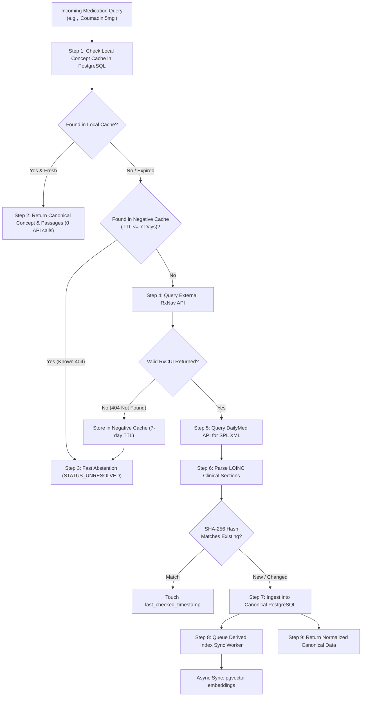

# RxGuard-RAG: Data Strategy, Clinical Catalog & Schemas

> **Status:** PLANNED SPECIFICATION (Documentation-Only Foundation)  
> **Repository:** [DAREDEVIL-OF-NEXUS/RxGuard-RAG](https://github.com/DAREDEVIL-OF-NEXUS/RxGuard-RAG)  
> **Data & Knowledge Leads:** Mudit Bansal, Hardik  
> **Collaborators:** Vasu Mittal, Lakshay Bharti  
> **Version:** 2.0.0 (Four-Team Master Specification)  
> **Date:** October 2026

---

## 1. Authoritative Clinical Data Sources Catalog

RxGuard-RAG ingests, normalizes, indexes, and traverses clinical evidence exclusively from recognized, publicly documented regulatory and informatics authorities.

### 1.1. Source Comparison & Specification Matrix

| Source Name | Canonical URL | Data Type | Primary Clinical Utility | Access Method & Rate Limits | License / Permitted Use | Overlap & Conflict Handling |
|---|---|---|---|---|---|---|
| **NLM DailyMed** | [https://dailymed.nlm.nih.gov/](https://dailymed.nlm.nih.gov/) | Structured Product Labeling (SPL XML) | Authoritative FDA package inserts: Boxed Warnings, DDI, Contraindications, Inactive Ingredients | REST API & weekly ZIP bulk downloads. Public access (no key). | Public Domain (US Government Work) | Canonical source for full label text; takes precedence over openFDA on conflicting text extracts. |
| **openFDA Drug Labeling API** | [https://open.fda.gov/apis/drug/label/](https://open.fda.gov/apis/drug/label/) | JSON-structured FDA drug labels | Rapid lookup, NDC mapping, structured recall flags, and secondary cross-validation | REST API (`/drug/label.json`). 240 req/min with API key. | CC0 / Public Domain | Overlaps heavily with DailyMed. Collapsed at the SPL SetID level via SHA-256 fingerprinting to prevent duplicate indexing. |
| **NIH NLM RxNorm & RxNav** | [https://rxnav.nlm.nih.gov/](https://rxnav.nlm.nih.gov/) | Normalized clinical drug terminology (RxCUI, TTY, Ingredients) | Brand-to-generic mapping, ingredient decomposition, salt form resolution | REST API (`/REST/rxcui`). 20 req/sec operational limit. | Open public data (NLM terms of service; UMLS licensing for proprietary source vocabularies) | Terminology standard only. Does not provide clinical interaction tables. |
| **FDA UNII (G-SRS)** | [https://precision.fda.gov/uniisearch](https://precision.fda.gov/uniisearch) | Unique Ingredient Identifiers (UNII) | Chemical substance identification for active moieties and inactive excipients | Bulk TSV downloads & REST search. Public access. | Public Domain | Ground truth for active and inactive substance identity; cross-referenced with patient allergen records. |
| **CDSCO / Sugam (India Context)** | [https://cdsco.gov.in/](https://cdsco.gov.in/) | Central Drugs Standard Control Organisation gazettes & approved lists | Cross-referencing Indian brand names and Fixed-Dose Combinations (FDCs) | Manual PDF gazette extracts & web portals (No public REST API). | Public Government Information (India) | Explicitly tagged with `jurisdiction="IN"`; never mixed with US FDA labeling without jurisdiction qualification. |

---

## 2. The 500-Medication Seed Strategy

To establish a comprehensive, clinically relevant baseline, the data engineering team will seed approximately **500 high-priority medication concepts** into the canonical PostgreSQL database.

### 2.1. Seed Selection Methodology
The 500 concepts are selected based on clinical priority, frequency of polypharmacy, and known interaction risks:
1. **Top 200 Outpatient Prescriptions:** Derived from public CMS Medicare Part D / ClinCalc outpatient prescription data (e.g., Atorvastatin, Levothyroxine, Lisinopril, Metformin, Amlodipine).
2. **Top 150 Critical Inpatient & Narrow Therapeutic Index (NTI) Drugs:** Anticoagulants (Warfarin, Apixaban), immunosuppressants (Tacrolimus, Cyclosporine), antiarrhythmics (Digoxin, Amiodarone), antiepileptics (Phenytoin, Carbamazepine, Lithium).
3. **Top 100 High-Frequency Interaction & Contraindication Pairs:** Chemotherapeutics (Methotrexate, Fluorouracil), NSAIDs (Ibuprofen, Naproxen, Ketorolac), PDE-5 inhibitors (Sildenafil), and SSRI/SNRIs.
4. **Top 50 Common Over-the-Counter (OTC) Products & Common Fixed-Dose Combinations (FDCs):** Acetaminophen, Diphenhydramine, Omeprazole, Amoxicillin-Clavulanate.

### 2.2. Concepts vs. Products vs. Formulations
> [!IMPORTANT] Concepts $\neq$ Products
> Seeding 500 medication concepts does **not** equal 500 individual product labels.
> - A single **MedicationConcept** (e.g., *Warfarin*, RxCUI `11289`) maps to dozens of **DrugProducts** (e.g., Coumadin 1mg, 2mg, 5mg tablets by Bristol-Myers Squibb, Jantoven by Upsher-Smith).
> - Different strengths, routes (oral vs. IV), and dosage forms (extended release vs. immediate release) may carry distinct labeling warnings.
> - The seeder links each canonical `MedicationConcept` to its representative SPL SetIDs, indexing the underlying clinical label sections once per unique SetID.

---

## 3. Local-First / Cache-First Retrieval & Ingestion Strategy



### Negative Caching & Fail-Safe Policies
- **Negative Caching:** When an external API definitively returns 404 for an invalid medication query, a negative cache entry is recorded with a **7-day Time-To-Live (TTL)** to prevent repeated rate-limit depletion.
- **Fail-Safe Integrity:** If an external API returns 500, network timeout, or rate-limit error, the system **never** assumes the drug is safe or non-existent. It records `check_unavailable` or `insufficient_evidence` with an explicit external service warning.

---

## 4. Tri-Database Persistence Schemas

### 4.1. PostgreSQL Relational Schema (Canonical Single Source of Truth)

```sql
-- Illustrative Canonical Schema (PostgreSQL 16+)

CREATE TABLE users (
    user_id UUID PRIMARY KEY DEFAULT gen_random_uuid(),
    username VARCHAR(64) UNIQUE NOT NULL,
    email VARCHAR(255) UNIQUE NOT NULL,
    password_hash VARCHAR(255) NOT NULL, -- Argon2id hash
    role VARCHAR(32) NOT NULL DEFAULT 'ROLE_USER',
    is_2fa_enabled BOOLEAN DEFAULT FALSE,
    totp_secret VARCHAR(64),
    created_at TIMESTAMPTZ DEFAULT NOW(),
    updated_at TIMESTAMPTZ DEFAULT NOW()
);

CREATE TABLE user_allergies (
    allergy_id UUID PRIMARY KEY DEFAULT gen_random_uuid(),
    user_id UUID REFERENCES users(user_id) ON DELETE CASCADE,
    substance_name VARCHAR(255) NOT NULL,
    unii VARCHAR(32),
    allergy_class VARCHAR(128),
    severity VARCHAR(32) DEFAULT 'UNKNOWN',
    verification_source VARCHAR(64) DEFAULT 'USER_REPORTED',
    created_at TIMESTAMPTZ DEFAULT NOW()
);

CREATE TABLE user_conditions (
    condition_id UUID PRIMARY KEY DEFAULT gen_random_uuid(),
    user_id UUID REFERENCES users(user_id) ON DELETE CASCADE,
    condition_name VARCHAR(255) NOT NULL,
    icd10_code VARCHAR(16),
    diagnosed_date DATE,
    created_at TIMESTAMPTZ DEFAULT NOW()
);

CREATE TABLE medication_concepts (
    rxcui VARCHAR(32) PRIMARY KEY,
    canonical_name VARCHAR(255) NOT NULL,
    term_type VARCHAR(16) NOT NULL,
    synonyms TEXT[],
    jurisdiction VARCHAR(16) DEFAULT 'US',
    is_ambiguous BOOLEAN DEFAULT FALSE,
    created_at TIMESTAMPTZ DEFAULT NOW(),
    updated_at TIMESTAMPTZ DEFAULT NOW()
);

CREATE TABLE drug_products (
    ndc VARCHAR(32) PRIMARY KEY,
    rxcui VARCHAR(32) REFERENCES medication_concepts(rxcui),
    brand_name VARCHAR(255) NOT NULL,
    generic_name VARCHAR(255) NOT NULL,
    dosage_form VARCHAR(64),
    strength VARCHAR(64),
    spl_setid VARCHAR(64) NOT NULL,
    active_ingredient_uniis TEXT[],
    inactive_excipient_uniis TEXT[],
    jurisdiction VARCHAR(16) DEFAULT 'US'
);

CREATE TABLE source_documents (
    document_id VARCHAR(64) PRIMARY KEY, -- DailyMed SPL SetID
    source_name VARCHAR(64) NOT NULL,
    source_url TEXT NOT NULL,
    version VARCHAR(32) NOT NULL,
    effective_date DATE,
    sha256_hash VARCHAR(64) NOT NULL,
    jurisdiction VARCHAR(16) DEFAULT 'US',
    retrieval_timestamp TIMESTAMPTZ DEFAULT NOW()
);

CREATE TABLE evidence_passages (
    passage_id UUID PRIMARY KEY DEFAULT gen_random_uuid(),
    document_id VARCHAR(64) REFERENCES source_documents(document_id),
    rxcui VARCHAR(32) REFERENCES medication_concepts(rxcui),
    loinc_section_code VARCHAR(32) NOT NULL,
    section_title VARCHAR(128) NOT NULL,
    passage_index INT NOT NULL,
    content TEXT NOT NULL,
    sha256_hash VARCHAR(64) NOT NULL,
    chunk_version VARCHAR(16) NOT NULL,
    created_at TIMESTAMPTZ DEFAULT NOW()
);

CREATE TABLE deterministic_safety_rules (
    rule_id VARCHAR(64) PRIMARY KEY,
    rule_type VARCHAR(32) NOT NULL, -- DDI, DFI, DCI, ALLERGY
    subject_rxcui VARCHAR(32) REFERENCES medication_concepts(rxcui),
    interacting_rxcui VARCHAR(32) REFERENCES medication_concepts(rxcui),
    condition_icd10 VARCHAR(16),
    food_name VARCHAR(128),
    allergen_class VARCHAR(128),
    severity VARCHAR(32) NOT NULL,
    clinical_consequence TEXT NOT NULL,
    source_document_ids TEXT[],
    status VARCHAR(16) DEFAULT 'ACTIVE',
    version VARCHAR(16) DEFAULT '1.0.0'
);

CREATE TABLE audit_logs (
    trace_id UUID PRIMARY KEY DEFAULT gen_random_uuid(),
    user_id UUID,
    endpoint VARCHAR(128) NOT NULL,
    input_hash VARCHAR(64) NOT NULL,
    status_emitted VARCHAR(64) NOT NULL,
    findings_count INT DEFAULT 0,
    cited_passage_ids UUID[],
    latency_ms INT NOT NULL,
    created_at TIMESTAMPTZ DEFAULT NOW()
);

CREATE TABLE derived_sync_status (
    sync_id UUID PRIMARY KEY DEFAULT gen_random_uuid(),
    entity_id VARCHAR(64) NOT NULL,
    target_store VARCHAR(32) NOT NULL, -- 'PGVECTOR' ('NEO4J' is a legacy value; no consumer remains)
    sync_status VARCHAR(16) NOT NULL, -- 'PENDING', 'SYNCED', 'FAILED'
    version VARCHAR(32) NOT NULL,
    error_message TEXT,
    last_attempt TIMESTAMPTZ DEFAULT NOW()
);
```

### 4.2. Derived Vector & Lexical Schema (`pgvector` & `tsvector`)

```sql
-- pgvector Extension & Lexical Indexing
CREATE EXTENSION IF NOT EXISTS vector;

-- Embedding table linked to canonical evidence passages
CREATE TABLE evidence_embeddings (
    passage_id UUID PRIMARY KEY REFERENCES evidence_passages(passage_id) ON DELETE CASCADE,
    embedding vector(1536), -- 1536 for text-embedding-3-small, or 384 for bge-small
    embedding_model VARCHAR(64) NOT NULL,
    created_at TIMESTAMPTZ DEFAULT NOW()
);

-- HNSW Vector Index for fast cosine similarity search
CREATE INDEX idx_evidence_embeddings_hnsw 
ON evidence_embeddings 
USING hnsw (embedding vector_cosine_ops) 
WITH (m = 16, ef_construction = 64);

-- Full-text GIN index on canonical evidence passages for BM25-style lexical search
ALTER TABLE evidence_passages ADD COLUMN search_vector tsvector 
GENERATED ALWAYS AS (to_tsvector('english', section_title || ' ' || content)) STORED;

CREATE INDEX idx_evidence_passages_tsvector 
ON evidence_passages 
USING gin (search_vector);
```

### 4.3. Evidence Graph (no graph database)

The Neo4j graph schema was retired in the October 2026 simplification (architecture.md ADR-005). The Evidence Navigator's provenance graph (finding -> medications -> passages -> documents) is built on demand from the safety engine's findings and these relational tables.

---

## 5. Synthetic Evaluation Dataset Plan

The evaluation suite consists of **50 hand-crafted synthetic clinical scenarios** spanning:
1. **20 High-Severity Drug–Drug Interaction Cases:**
   - Methotrexate + Ibuprofen (Severe bone marrow suppression / renal clearance toxicity).
   - Warfarin + Amiodarone (CYP2C9 inhibition, extreme INR spike, bleeding).
   - Simvastatin + Clarithromycin (CYP3A4 inhibition, severe rhabdomyolysis).
   - Sildenafil + Nitroglycerin (Fatal profound hypotension).
2. **10 Drug–Food Interaction Cases:**
   - Atorvastatin + Grapefruit Juice (CYP3A4 inhibition, myopathy risk).
   - Phenelzine (MAOI) + Aged Cheeses/Tyramine (Hypertensive crisis).
   - Ciprofloxacin + Dairy/Calcium (Chelation, reduced antibiotic bioavailability).
3. **10 Drug–Condition Contraindication Cases:**
   - Propranolol in Severe Asthma (Bronchospasm, death).
   - Metformin in Severe Chronic Kidney Disease eGFR < 30 (Lactic acidosis).
   - Celecoxib in Active Peptic Ulcer Disease (Perforation, hemorrhage).
4. **10 Allergy & Excipient Cross-Sensitivity Cases:**
   - Amoxicillin in severe Penicillin-anaphylactic patient.
   - Tartrazine (FD&C Yellow No. 5) dye in Aspirin-sensitive asthma patient.
   - Lactose monohydrate excipient in patient with severe galactosemia.

*All 50 scenarios are stored in `data/benchmark/scenarios_50.json` and are evaluated against precision, recall, MRR, RAGAS faithfulness, and clinical safety sensitivity.*
