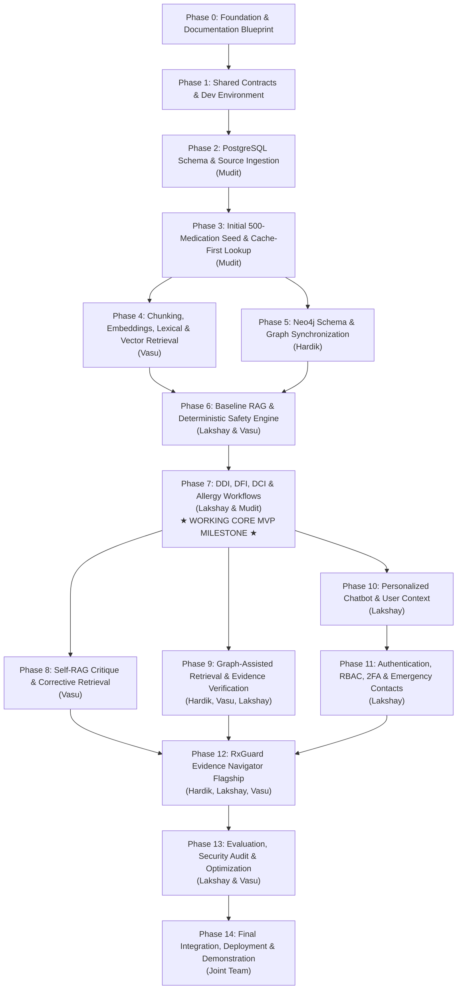

# RxGuard-RAG: Phased Implementation Roadmap & Dependency Graph

> **Status:** PLANNED SPECIFICATION (Documentation-Only Foundation)  
> **Repository:** [DAREDEVIL-OF-NEXUS/RxGuard-RAG](https://github.com/DAREDEVIL-OF-NEXUS/RxGuard-RAG)  
> **Team:** Lakshay Bharti, Vasu Mittal, Mudit Bansal, Hardik  
> **Version:** 2.0.0 (Four-Team Master Specification)  
> **Date:** October 2026

---

## 1. Master Dependency Graph (Phases 0 through 14)

The project follows a 15-phase dependency-aware progression designed to achieve an **integrated working MVP early (Phases 6–7)** while systematically layering Neo4j graph capabilities, Self-RAG critique, user personalization, and the Evidence Navigator flagship feature.

---

## 2. Four-Team Responsibility Matrix by Phase

| Phase | Phase Name | Primary Lead | Secondary / Reviewers | Key Deliverables & Module Paths |
|---|---|---|---|---|
| **Phase 0** | Foundation & Blueprint | Lakshay | Vasu, Mudit, Hardik | 9 documentation files, `.gitignore`, scaffold directories. |
| **Phase 1** | Shared Contracts & Environment | Lakshay | All | Pydantic contracts, Docker Compose (PostgreSQL, pgvector, Neo4j), CI hooks. |
| **Phase 2** | PostgreSQL Schema & Ingestion | Mudit | Lakshay | DailyMed SPL adapter, openFDA client, RxNav normalizer, SQLAlchemy models. |
| **Phase 3** | 500-Concept Seed & Cache-First | Mudit | Hardik, Vasu | Seed data loader (500 RxCUIs), cache-first lookup worker, negative cache. |
| **Phase 4** | Lexical & Vector Retrieval | Vasu | Mudit | Clinical chunker, embedding generator, pgvector HNSW index, tsvector GIN index. |
| **Phase 5** | Neo4j Schema & Graph Sync | Hardik | Mudit | Neo4j constraints, Cypher queries, PostgreSQL-to-Neo4j sync worker. |
| **Phase 6** | Baseline RAG & Safety Engine | Lakshay / Vasu | Mudit, Hardik | Baseline RAG pipeline, pairwise DDI checker, preliminary API endpoints. |
| **Phase 7** | Four Clinical Safety Workflows | Lakshay | Mudit, Vasu | **WORKING CORE MVP**: DDI, DFI, DCI, and Allergy screening fully functional. |
| **Phase 8** | Self-RAG & Corrective Retrieval | Vasu | Lakshay | CRAG confidence scoring, query rewriter, Self-RAG reflection token loops. |
| **Phase 9** | Graph-Assisted Retrieval & Verification | Hardik / Vasu | Lakshay | Neo4j multi-hop expansion, sentence-level NLI entailment verification. |
| **Phase 10** | Personalized Chatbot | Lakshay | Vasu | User context injection, isolated conversation history, safety-grounded chat. |
| **Phase 11** | Auth, RBAC, 2FA & Emergency | Lakshay | Hardik | Argon2id hashing, JWT, TOTP 2FA (RFC 6238), RBAC, emergency contact flow. |
| **Phase 12** | Evidence Navigator Flagship | Hardik / Lakshay | Vasu, Mudit | **FLAGSHIP WOW FEATURE**: Interactive evidence graph explorer and subgraph API. |
| **Phase 13** | Evaluation & Security Hardening | Lakshay / Vasu | Mudit, Hardik | 50-case benchmark suite, RAGAS metrics, bandit/safety security scans. |
| **Phase 14** | Deployment & Final Demo | Joint Team | All | Production Docker Compose, deployment guide, demonstration video. |

---

## 3. Phase-by-Phase Execution Specifications

### Phase 0: Repository Foundation & Documentation Blueprint
- **Objective:** Establish complete, unambiguous technical specifications for four developers and their independent AI coding agents.
- **Deliverables:** `README.md`, `architecture.md`, `phases.md`, `data.md`, `checklist.md`, `Mudit.md`, `Vasu.md`, `Hardik.md`, `Lakshay.md`, `CONTRIBUTING.md`, `SECURITY.md`, `.gitignore`, and directory scaffold.
- **Dependencies:** None.
- **Responsible Owner:** Lakshay Bharti (lead) with Vasu Mittal, Mudit Bansal, Hardik.
- **Acceptance Criteria:** All files committed to `main` with zero lint errors; all Mermaid diagrams syntactically valid; directory scaffold created with `.gitkeep` placeholders.
- **Tests Required:** Markdown link validator and Mermaid syntax check.
- **Deferred:** All runtime Python code, API servers, and database migrations.

### Phase 1: Shared Contracts & Development Environment
- **Objective:** Configure containerized multi-database stack and establish immutable shared contracts.
- **Deliverables:** `pyproject.toml`, `docker-compose.yml` (PostgreSQL 16 + pgvector, Neo4j 5.20+ Community/Enterprise, Redis cache), pre-commit hooks (ruff, black, mypy), and `src/rxguard/core/contracts/`.
- **Dependencies:** Phase 0.
- **Responsible Owner:** Lakshay Bharti (reviewed by Mudit, Vasu, Hardik).
- **Acceptance Criteria:** `docker compose up` brings up PostgreSQL, pgvector, and Neo4j cleanly; Pydantic contract tests pass.
- **Tests Required:** `tests/contract/test_contracts.py` testing serialization of all 8 core models.
- **Integration Checkpoint:** All four developers verify local multi-container boot.

### Phase 2: PostgreSQL Schema & Source Ingestion
- **Objective:** Build robust adapters to ingest DailyMed SPL XML and openFDA labels, parse clinical sections, and normalize drug entities via RxNav.
- **Deliverables:** `src/rxguard/ingestion/` (`dailymed.py`, `openfda.py`, `rxnav.py`), `src/rxguard/database/models.py`, Alembic migrations.
- **Dependencies:** Phase 1.
- **Responsible Owner:** Mudit Bansal.
- **Acceptance Criteria:** Successful parsing of test SPL XMLs with extracted LOINC sections (34066-1, 34070-2, 34073-6, 43685-7, 51727-6) stored in PostgreSQL.
- **Tests Required:** `tests/unit/test_adapters.py`, `tests/unit/test_spl_parser.py` using mocked HTTP fixtures.
- **Integration Checkpoint:** Mudit publishes `MedicationNormalizer` and canonical database models.

### Phase 3: Initial Medication Seed & Cache-First Lookup
- **Objective:** Ingest and seed top ~500 high-priority medication concepts and establish local-first lookup with negative caching.
- **Deliverables:** `src/rxguard/ingestion/seed_loader.py`, `data/seed/top_500_concepts.json`, cache-first lookup worker.
- **Dependencies:** Phase 2.
- **Responsible Owner:** Mudit Bansal.
- **Acceptance Criteria:** 500 core medications populated in PostgreSQL; queries check local DB first, hitting external APIs only on cache misses with 7-day negative caching for 404s.
- **Tests Required:** `tests/unit/test_cache_first.py` verifying cache hits, cache misses, and negative cache TTL.
- **Integration Checkpoint:** Hardik and Vasu consume seeded PostgreSQL tables for graph and vector indexing.

### Phase 4: Chunking, Embeddings, Lexical & Vector Retrieval
- **Objective:** Implement clinical boundary chunking, dense embeddings, pgvector HNSW indexing, and PostgreSQL tsvector lexical search.
- **Deliverables:** `src/rxguard/retrieval/chunker.py`, `src/rxguard/vector_store/`, `src/rxguard/retrieval/lexical.py`, `src/rxguard/retrieval/hybrid.py`.
- **Dependencies:** Phase 3.
- **Responsible Owner:** Vasu Mittal.
- **Acceptance Criteria:** Passages chunked with clinical headers; pgvector cosine search and tsvector GIN search execute in < 100ms; RRF fusion combines results.
- **Tests Required:** `tests/retrieval/test_vector_search.py`, `tests/retrieval/test_hybrid_rrf.py`.
- **Integration Checkpoint:** Vasu provides `HybridRetriever.search(query, top_k)`.

### Phase 5: Neo4j Schema & Graph Synchronization
- **Objective:** Deploy Neo4j schema, define node labels, uniqueness constraints, and implement asynchronous PostgreSQL-to-Neo4j synchronization.
- **Deliverables:** `src/rxguard/graph/` (`schema.py`, `sync_worker.py`, `client.py`), Cypher migration scripts.
- **Dependencies:** Phase 3.
- **Responsible Owner:** Hardik.
- **Acceptance Criteria:** Neo4j constraints enforced; seeded 500 medications synced into graph nodes and relationships with provenance properties; idempotent sync verified.
- **Tests Required:** `tests/unit/test_graph_schema.py`, `tests/integration/test_graph_sync.py`.
- **Integration Checkpoint:** Hardik provides `GraphService.get_subgraph(rxcui)` for Vasu and Lakshay.

### Phase 6: Baseline RAG & Deterministic Safety Engine
- **Objective:** Wire baseline vector/lexical retrieval with initial deterministic rule screening for core pairwise drug interactions.
- **Deliverables:** `src/rxguard/safety/engine.py`, `src/rxguard/safety/ddi.py`, `src/rxguard/rag/baseline.py`, `POST /api/v1/safety/analyze` baseline endpoint.
- **Dependencies:** Phases 4, 5.
- **Responsible Owner:** Lakshay Bharti & Vasu Mittal.
- **Acceptance Criteria:** Pairwise drug query returns deterministic findings + grounded LLM summary with passage citations.
- **Tests Required:** `tests/safety/test_ddi_rules.py`, `tests/integration/test_baseline_rag.py`.
- **Integration Checkpoint:** Preliminary end-to-end API operational on `main`.

### Phase 7: Complete Four Clinical Safety Workflows (CORE MVP)
- **Objective:** Complete all four clinical safety screening workflows: DDI, DFI (food), DCI (contraindications), and Allergy/Excipient matching.
- **Deliverables:** `src/rxguard/safety/` (`dfi.py`, `contraindications.py`, `allergies.py`), seed rules for top 100 critical clinical hazards.
- **Dependencies:** Phase 6.
- **Responsible Owner:** Lakshay Bharti (lead) with Mudit Bansal.
- **Acceptance Criteria:** **MILESTONE: WORKING CORE MVP.** All 4 workflows pass automated unit tests; missing data emits `insufficient_evidence`; critical hazards emit `risk_identified`.
- **Tests Required:** `tests/safety/test_all_workflows.py`, `tests/end_to_end/test_mvp.py`.
- **Integration Checkpoint:** **TEAM DEMO 1 (MVP RELEASE).**

### Phase 8: Self-RAG-Inspired Critique & Corrective Retrieval (CRAG)
- **Objective:** Implement CRAG retrieval confidence scoring and Self-RAG reflection token loops.
- **Deliverables:** `src/rxguard/self_rag/` (`crag_evaluator.py`, `query_rewriter.py`, `self_critique.py`).
- **Dependencies:** Phase 7.
- **Responsible Owner:** Vasu Mittal.
- **Acceptance Criteria:** Retrieval scores < 0.40 trigger safe abstention; scores 0.40–0.74 trigger bounded query rewrite (max 2 retries); unfaithful sentences flagged.
- **Tests Required:** `tests/retrieval/test_crag.py`, `tests/retrieval/test_self_critique.py`.
- **Integration Checkpoint:** Advanced Self-RAG pipeline replaces baseline RAG in main API.

### Phase 9: Graph-Assisted Retrieval & Evidence Verification
- **Objective:** Integrate Neo4j multi-hop graph expansion into retrieval and verify claim-to-passage entailment via NLI.
- **Deliverables:** `src/rxguard/retrieval/graph_retriever.py`, `src/rxguard/evidence/claim_verifier.py`.
- **Dependencies:** Phases 5, 8.
- **Responsible Owner:** Hardik & Vasu (retrieval) with Lakshay (verification).
- **Acceptance Criteria:** Graph expansion fetches adjacent ingredient/contraindication nodes to enrich retrieval context; NLI verifier scores claim entailment.
- **Tests Required:** `tests/retrieval/test_graph_retrieval.py`, `tests/contract/test_claim_verifier.py`.
- **Integration Checkpoint:** API response includes verified citation badges (`VERIFIED` vs `UNVERIFIED`).

### Phase 10: Personalized Chatbot & User Context
- **Objective:** Deploy conversational safety chatbot that ingests authorized user profile, active medications, allergies, and conditions.
- **Deliverables:** `src/rxguard/chatbot/` (`orchestrator.py`, `prompt_manager.py`), `POST /api/v1/chat/message`.
- **Dependencies:** Phase 7.
- **Responsible Owner:** Lakshay Bharti.
- **Acceptance Criteria:** Chatbot incorporates user context strictly within authorized session; cross-user context leakage impossible; responses grounded in safety findings.
- **Tests Required:** `tests/security/test_user_isolation.py`, `tests/unit/test_chatbot.py`.
- **Integration Checkpoint:** Chatbot endpoint integrated with frontend client.

### Phase 11: Authentication, RBAC, 2FA & Emergency Contacts
- **Objective:** Implement secure user registration, Argon2id password hashing, JWT sessions, RBAC, TOTP 2FA (RFC 6238), and consent-driven emergency contacts.
- **Deliverables:** `src/rxguard/auth/` (`jwt.py`, `hasher.py`, `two_factor.py`), `src/rxguard/users/`, `src/rxguard/auth/emergency.py`.
- **Dependencies:** Phase 10.
- **Responsible Owner:** Lakshay Bharti.
- **Acceptance Criteria:** Protected routes reject unauthorized requests; 2FA challenge flow functions; emergency contact alert triggers only upon explicit user confirmation.
- **Tests Required:** `tests/security/test_auth.py`, `tests/security/test_rbac.py`, `tests/security/test_2fa.py`.
- **Integration Checkpoint:** Full security layer active across all API routes.

### Phase 12: RxGuard Evidence Navigator (Flagship Wow Feature)
- **Objective:** Build the interactive, bidirectional Evidence Navigator bridging user input, normalized concepts, deterministic findings, Neo4j subgraphs, and regulatory passages.
- **Deliverables:** `src/rxguard/evidence/navigator.py`, `src/rxguard/graph/subgraph_service.py`, UI graph visualization component.
- **Dependencies:** Phases 5, 7, 9.
- **Responsible Owner:** Hardik & Lakshay (with Vasu).
- **Acceptance Criteria:** API returns acyclic JSON subgraph representing traceable clinical provenance; UI renders interactive clickable nodes from medication to DailyMed passage.
- **Tests Required:** `tests/end_to_end/test_evidence_navigator.py`.
- **Integration Checkpoint:** **FLAGSHIP WOW FEATURE DEMO.**

### Phase 13: Evaluation, Security Testing & Performance Optimization
- **Objective:** Execute 50-case synthetic clinical evaluation suite; measure RAGAS metrics, clinical safety sensitivity, latency, and execute vulnerability scans.
- **Deliverables:** `src/rxguard/evaluation/` (`benchmark_runner.py`, `metrics.py`), evaluation reports, security audit report.
- **Dependencies:** Phases 8, 9, 11, 12.
- **Responsible Owner:** Lakshay Bharti & Vasu Mittal (with Mudit, Hardik).
- **Acceptance Criteria:** Zero critical vulnerabilities in `bandit` and `safety`; comprehensive comparative evaluation across 4 RAG configurations documented.
- **Tests Required:** Automated regression test suite executing all 50 synthetic benchmark scenarios.
- **Integration Checkpoint:** Final benchmark numbers validated and signed off.

### Phase 14: Final Integration, Deployment & Demonstration
- **Objective:** Complete production Docker containerization, write deployment documentation, verify end-to-end user workflows, and record demonstration video.
- **Deliverables:** Production `deployment/docker-compose.prod.yml`, deployment guide, final demonstration walkthrough script.
- **Dependencies:** All preceding phases.
- **Responsible Owner:** Joint Team (Lakshay, Vasu, Mudit, Hardik).
- **Acceptance Criteria:** Entire system boots via single command; demonstration covers DDI, DFI, DCI, Allergies, 2FA, Evidence Navigator, and Self-RAG abstention.
- **Integration Checkpoint:** **PROJECT RELEASE & FINAL DELIVERABLE.**
